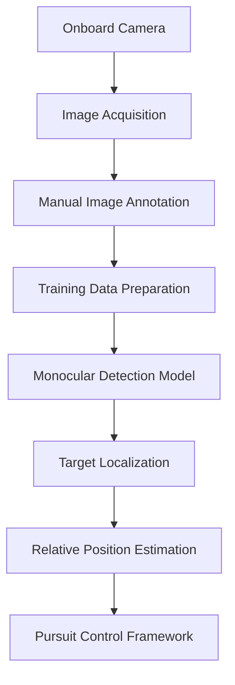

# Experimental Setup and Visual Documentation

## 1. Overview

The UAV pursuit research was conducted during the 2022 Mitacs Globalink Research Internship at the Department of Mechanical Engineering, University of Alberta.

The experimental framework investigated autonomous UAV pursuit through monocular visual perception, relative position estimation and closed-loop motion control.

The research involved both simulation environments and controlled indoor experimental facilities.

## 2. Experimental Objectives

The experimental activities investigated:

- Relative localization between two UAVs
- Vision-based target detection
- Monocular 3D object detection
- UAV image acquisition and annotation
- Motion-capture-based state measurement
- PID motion-control development
- MAVLink communication and flight operations

## 3. Experimental Hardware

| Component | Purpose |
|---|---|
| Parrot ANAFI UAV | Platform investigated during the internship |
| Onboard monocular camera | Visual observation of the target UAV |
| Vicon motion-capture system | External pose measurement and ground-truth tracking |
| Laboratory computing environment | Image processing, ROS communication and controller development |

The earlier Parrot AR.Drone 2.0 research provided the foundational pursuit-control framework.

## 4. Motion-Capture Environment

The experimental framework used Vicon motion capture to obtain UAV position and orientation information.

The motion-capture data supported:

- Global position measurement
- Quaternion-based orientation representation
- Relative pose processing
- Controller development
- Ground-truth comparison

ROS TF interfaces were investigated for processing coordinate transformations and communicating pose information.

## 5. UAV Image Acquisition

The research involved acquiring images of a target UAV from the perspective of a pursuer UAV.

According to the internship report, training imagery was collected while both UAVs were in flight.

The resulting images were used to investigate visual target localization and monocular 3D object detection.

## 6. Image Annotation

Manual image annotation was performed using LabelMe.

Two principal annotation approaches were investigated.

### 6.1 Keypoint Annotation

Keypoints were placed along relevant UAV boundaries and structural features.

These annotations provide information about:

- Object geometry
- Projected shape
- Relative orientation
- Structural features
- Apparent object size

### 6.2 Component and Bounding-Box Annotation

Component labels and bounding boxes were investigated to represent the visible structure and image-space location of the target UAV.

These annotations supported the investigation of monocular 2D-to-3D object localization.

## 7. Monocular 3D Perception Framework

The broader research investigated a BirdNet3D-derived approach to estimating the relative pose of a target UAV from monocular imagery.

The conceptual perception workflow was:

The complete trained perception model and training dataset are not included in this repository.

## 8. Simulation Environment

Simulation tools investigated during the internship included:

| Software | Purpose |
|---|---|
| PX4 | Flight-control simulation |
| jMAVSim | Simulated UAV flight |
| Parrot Sphinx | ANAFI simulation |
| Parrot Olympe | Python-based ANAFI development |
| MAVSDK | MAVLink communication and flight operations |

The internship report describes successful simulation of a MAVSDK-based flight-operation sequence using PX4 and jMAVSim.
