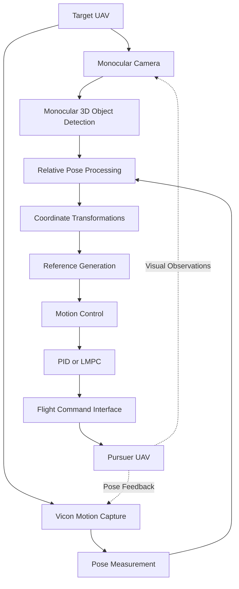
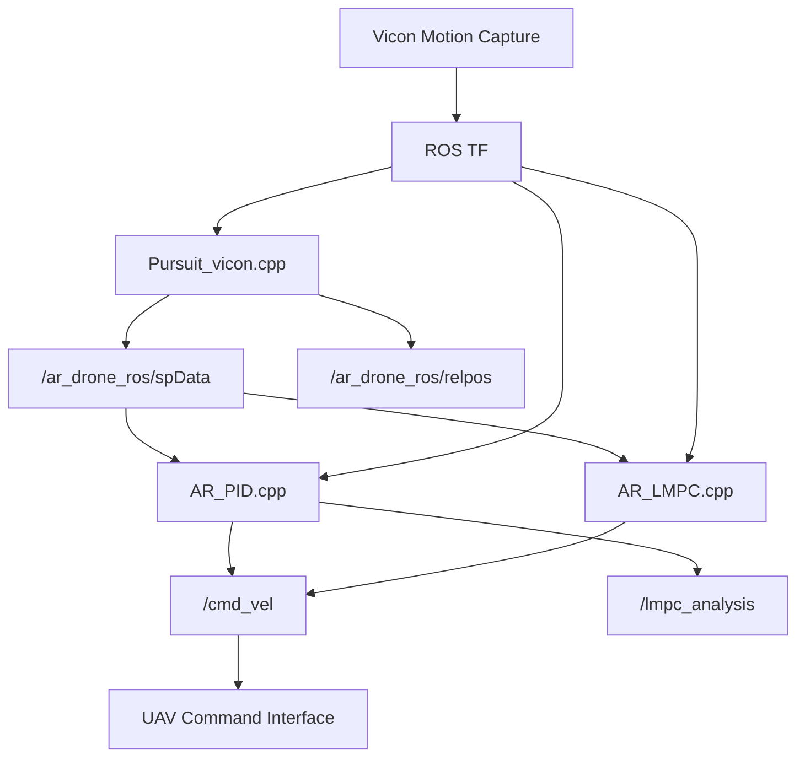
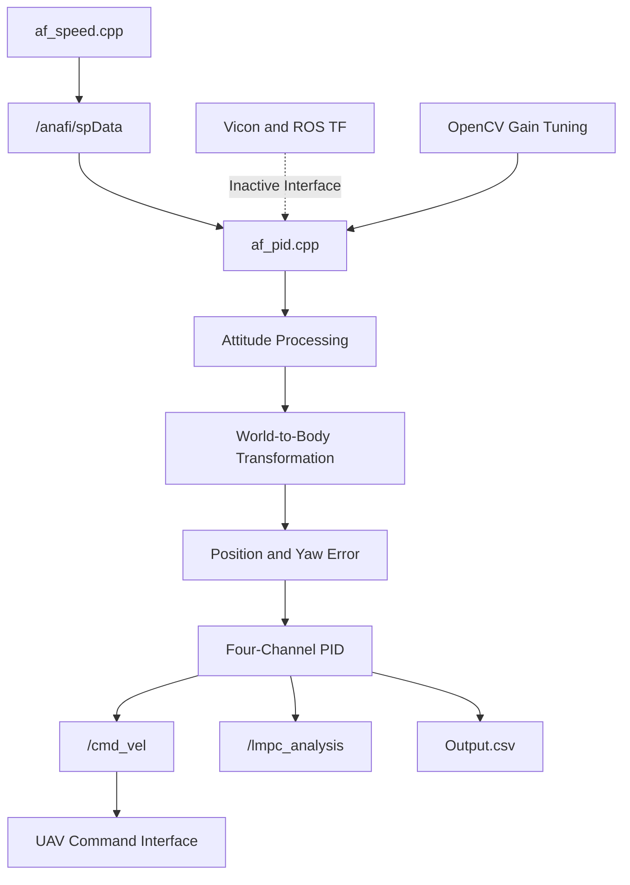
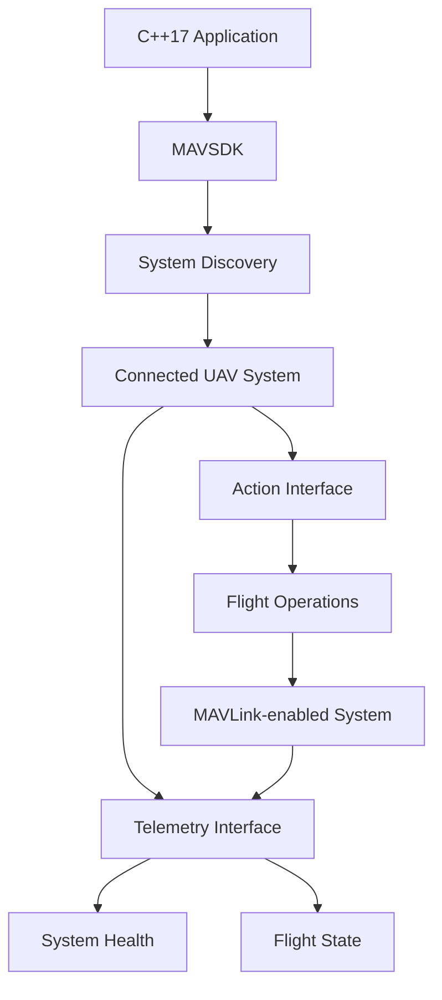

# System Architecture

## 1. Overview

This document describes the conceptual research architecture and the individual software modules retained from the 2022 Mitacs Globalink Research Internship at the University of Alberta.

The diagrams distinguish the broader research framework from the archived source-code implementations.

## 2. Overall Research Architecture

The research investigates autonomous UAV pursuit through relative localization, visual perception, reference generation and closed-loop motion control.

This diagram represents the conceptual research framework. It does not imply that all components are integrated into a single executable implementation within this repository.

The monocular perception model and complete training dataset are not included.

## 3. ROS Control Architecture

### 3.1 AR.Drone Framework

The archived AR.Drone framework contains Vicon-based pursuit reference generation and alternative PID and LMPC controllers.

The PID and LMPC implementations represent alternative motion-control approaches. They are not intended to publish competing commands simultaneously.

### 3.2 ANAFI Framework

The ANAFI implementation separates reference setpoint publication from PID motion control.

The ANAFI PID node is structured around a nominal 25 Hz ROS loop. The reference publisher operates at 0.5 Hz.

The Vicon transform lookup is commented out in the archived ANAFI implementation. Therefore, the diagram identifies this feedback interface as inactive.

## 4. ROS Communication Interfaces

| Topic | Function |
|---|---|
| `/ar_drone_ros/spData` | AR.Drone reference setpoints |
| `/ar_drone_ros/relpos` | Relative UAV position information |
| `/anafi/spData` | ANAFI reference setpoints |
| `/cmd_vel` | Motion-control commands |
| `/lmpc_analysis` | Controller analysis and trajectory information |

The topic names are retained from the original source code.

The AR.Drone and ANAFI implementations use different ROS package namespaces and are not directly interchangeable.

## 5. MAVSDK Flight-Operation Architecture

The repository includes a separate CMake-based C++17 application for investigating MAVLink communication and UAV flight operations.

Relevant implementation:

- [takeoff_and_land](../src/takeoff_and_land/)
- [mavlink_takeoff.cpp](../src/mavlink_takeoff.cpp)
- [mavtakeoff.cpp](../src/mavtakeoff.cpp)

The MAVSDK module is an independent experimental implementation rather than a verified integrated component of the ROS pursuit controller.

## 6. Architecture Scope and Limitations

- The overall research diagram represents the conceptual pursuit framework.
- The ROS diagrams represent interfaces identified in the archived source code.
- The AR.Drone and ANAFI implementations retain different package configurations.
- The ANAFI Vicon feedback lookup is inactive.
- The perception model is not distributed in this repository.
- End-to-end integration and standalone build reproducibility have not been independently verified.
- The original research implementations have been preserved.

See also:

- [Project README](../README.md)
